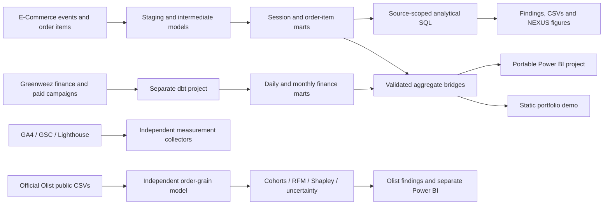

# NEXUS Commerce Intelligence


**A reproducible commerce analytics case study: raw events and order lines → tested dbt marts → analytical findings → Power BI and an English-language demo.**

E-Commerce and Greenweez share engineering standards while retaining independent facts, populations and financial definitions. This is a non-commercial portfolio project.

[Olist advanced analysis](docs/advanced-analysis/REPORT.md) · [Synthetic mart findings](docs/analysis/REPORT.md) · [Architecture](docs/ARCHITECTURE.md) · [Power BI](powerbi/README.md) · [Delivery evidence](docs/DELIVERY.md)


*Generated analytical figure from the official public Olist extract; not a dashboard screenshot. Olist research is independent of the synthetic E-Commerce/Greenweez web demonstration.*

## Advanced public-data study

The [Olist report](docs/advanced-analysis/REPORT.md) reconstructs a **99,441-order** source into a tested order-grain model. Its main January 2017–July 2018 purchase window includes **89,860 delivered orders**. No order identifiers or review text are published.

| Method | Question and control |
| --- | --- |
| Observation-aware cohorts | How many original customers return at the same cohort age? Future cells are null; observed inactivity is zero |
| As-of RFM policies | Which customers have repeated and how recently? Delivery-time eligibility prevents future outcomes; equal histories stay together |
| Exact Shapley decomposition | How do order volume, basket size and item value account for monthly GMV change? All six replacement orders reconcile exactly |
| Cluster bootstrap | How strongly are late delivery and poor reviews associated? Resample customers with all their orders; report uncertainty and selection limits |
| Sensitivity and multiplicity | How does review timing change the contrast? Compare response populations, standardize common months and publish the full exploratory state FDR family |

The weighted month-1 repeat rate is **0.48%**, replacing an unsupported historical 3–5% notebook claim. Delivery contrasts change substantially with review timing; the report presents this sensitivity prominently. These are historical marketplace observations, not causal effects, forecasts, audited financial results or current business performance.

Reproduce with `python -m scripts.advanced_olist --raw target/olist/raw`; exact source-file hashes, aggregate CSVs, eligibility and methods are recorded in [evidence](docs/advanced-analysis/evidence.json). Obtain the four named official CSVs with the free Kaggle CLI as described in the report. Raw files remain in ignored `target/` and are never downloaded in CI.

The separate [five-page Olist Power BI package](powerbi/NEXUS_Olist_Research.zip) embeds only these public aggregates. Rebuild it with `python -m scripts.build_olist_powerbi`; native Desktop/DAX acceptance remains unverified.

## Questions this project answers

| Question | Implementation | Interpretation |
| --- | --- | --- |
| Which channels contribute completed revenue? | [Channel performance](analyses/channel_performance.sql) | Current completed-line value; returns are not subtracted twice |
| Where does the journey narrow? | [Ordered funnel](analyses/conversion_funnel.sql) | Page view → cart → purchase within one session/user pair |
| Do channel conversion differences support a conclusion? | [Statistical diagnostics](analyses/channel_conversion_significance.sql) | Expected-cell checks and descriptive Wilson intervals; no causal claims |
| Which products merit investigation? | [Product analysis](analyses/top_products.sql) | Revenue and returned-item share with small-sample caveats |
| How much contribution remains after advertising? | [Greenweez finance](integrations/greenweez/) | Independent finance and campaign marts; no cross-merchant revenue total |

The [analysis report](docs/analysis/REPORT.md) includes full aggregate CSVs, query hashes, independent source-to-mart reconciliation, limitations and decision implications. The public fixture is suitable for demonstrating methods, not estimating real business performance.

## Architecture



BigQuery is the existing warehouse target; DuckDB reproduces both dbt projects locally. The public demo never queries BigQuery, invokes an LLM or needs a payment provider. The [migration record](docs/REPOSITORY_CONSOLIDATION.md) documents the single-repository consolidation.

## Reproduce locally

Python 3.11 and Node.js 22 or later are recommended. From the repository root:

```powershell
python -m pip install -r requirements-dev.txt
python -m scripts.build_demo --deps
```

This runs both source-scoped dbt pipelines, imports only synthetic aggregates and produces:

| Output | Location |
| --- | --- |
| Analytical findings and charts | `target/analysis/REPORT.md` |
| Static NEXUS demo | `target/showcase/` |
| Portable, four-page Power BI project | `target/powerbi-public/project/NEXUS_Commerce.pbip` |

If the dbt databases are already built, `python -m scripts.build_demo --skip-dbt` regenerates the analytical and presentation outputs. No browser or PC screen automation is used by these commands.

To view the static demo yourself:

```powershell
python -m http.server 8787 --bind 127.0.0.1 --directory target/showcase
```

Open `http://127.0.0.1:8787`. The demo supports domain switching, inclusive date filters, missing-period states and aggregate CSV export. The [existing Commerce Lab](https://nexus-commerce-lab.vercel.app/) remains a separate test-checkout experiment.

## Power BI

The [portable report package](powerbi/NEXUS_Commerce_Demo.zip) contains four native pages: Source Assurance, Historical E-Commerce, E-Commerce Sessions and Greenweez Finance. Aggregate demo rows are embedded in Power Query, so the project has no machine-specific CSV paths or cloud login requirement.

The seven-page private-source generator remains available as `python -m scripts.build_powerbi`. The public exporter rejects external/unverified source snapshots and excludes account measurements and import audits.

**Verification boundary:** Microsoft JSON schema validation, native TOM/TMDL parsing, field bindings, geometry and portability are checked in code. Power BI Desktop rendering, DAX execution and refresh are not verified. The package must not be presented as a published or visually accepted BI service report. See [Power BI delivery](powerbi/README.md).

## Source and metric contracts

- [KPI semantics](docs/COMMERCE_KPI_SEMANTICS.md): completed-line revenue, returns, orders, sessions and attribution.
- [Greenweez source contract](integrations/greenweez/README.md): independent finance/campaign pipeline and known data-quality warnings.
- [Google measurement](docs/GOOGLE_MEASUREMENT_INTEGRATION.md): GA4, Search Console and performance measurements.
- [BigQuery OIDC](docs/GITHUB_ACTIONS_BIGQUERY_OIDC.md): keyless metadata verification.
- [Olist controlled analysis](docs/advanced-analysis/REPORT.md): independent public data, tested SQL and statistical methods; historical notebooks are exploratory references.

Daily distinct order counts are labelled **order-days** when added across dates. They are not guaranteed to equal period-distinct orders. The analytical report recomputes period-distinct orders directly from the fact table. Currency is not inferred from unverified source units.

## Verification

```powershell
python -m unittest discover -s tests -p "test_*.py"
node --test showcase/tests/*.test.mjs storefront/tests/*.test.mjs
python -m scripts.run_analysis
python -m scripts.powerbi_structure_audit --out target/powerbi
python -m scripts.validate_powerbi_schema
python -m scripts.repo_hygiene_guard
```

The Microsoft schema check downloads and caches published schemas; the remaining commands operate locally without cloud credentials. [Delivery evidence](docs/DELIVERY.md) records results and remaining limits. Visual UI acceptance is deliberately unclaimed because this development pass uses neither Playwright nor a PC screen.

## Repository map

```text
analyses/                Business questions and executable analytical SQL
models/                  E-Commerce staging, intermediate and mart contracts
integrations/greenweez/   Independent finance/campaign dbt project
scripts/                 Collectors, validation, analysis and portable builders
tests/                   Counting, privacy, source and pipeline regressions
showcase/                English-language static NEXUS presentation
powerbi/                 Native report package, theme and delivery guide
dashboard/               Private-source Streamlit workspace
storefront/              Separate consent-based test checkout lab
notebooks/               Independent Olist analysis
docs/analysis/           Reproducible analytical findings, figures and CSVs
```

**Cost:** local open-source processing and static assets; no subscriptions, payment integration or custom domain. Private cloud extraction remains explicit and bounded. No new hosted service or scheduled refresh is enabled.

[MIT License](LICENSE)
