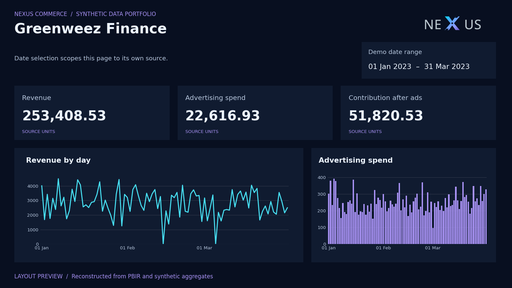
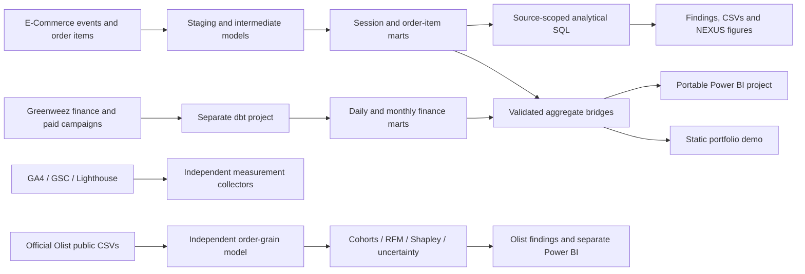

# NEXUS Commerce Intelligence


[](https://github.com/senanurcetin/nexus-commerce-intelligence/actions/workflows/ci.yml)
[](LICENSE)

An analytics project that combines source-scoped dbt models, reproducible statistical studies of the public Olist marketplace data and editable Power BI reports, all buildable locally without cloud credentials.

## Key results

From the [Olist study](docs/advanced-analysis/REPORT.md): a **99,441-order** source rebuilt into a tested order-grain model, with **89,860 delivered orders** in the January 2017–July 2018 window.

| Finding | Result | Report |
| --- | --- | --- |
| Weighted month-1 repeat rate | **0.48%** (replaces an unsupported 3–5% notebook figure) | [Report](docs/advanced-analysis/REPORT.md) |
| 90-day repeat-day probability, 86,950 customers | **1.29%** pooled, **1.31%** among fully observed customers | [Customer timing](docs/advanced-analysis/CUSTOMER_PORTFOLIO.md) |
| Item GMV share of the top 10 of 30,015 products | **3.46%** | [Customer timing](docs/advanced-analysis/CUSTOMER_PORTFOLIO.md) |
| Late delivered-order rate, January–July | **3.63% → 7.94%** year over year | [Delivery readout](docs/advanced-analysis/DELIVERY_OPERATIONS.md) |
| Poor-rating gap, late vs on-time, 30 days (68,448 orders) | **+11.26 pp** available-case; **−5.44 to +69.44 pp** full-rating range | [Review selection](docs/advanced-analysis/REVIEW_SELECTION.md) |
| Seven-day forecast MAE, 30 future weeks / 210 days | **41.19** orders/day vs **40.50** seasonal naive; improvement interval **−4.67 to +3.06** | [Forecast validation](docs/advanced-analysis/FORECAST_VALIDATION.md) |

**More:** [reproduction](docs/RESEARCH_REPRODUCIBILITY.md) · [decision readout](docs/EXECUTIVE_READOUT.md) · [synthetic mart findings](docs/analysis/REPORT.md) · [architecture](docs/ARCHITECTURE.md) · [KPI catalog](docs/KPI_CATALOG.md) · [documentation map](docs/README.md).

## Demo



*Greenweez Finance layout preview, rendered from the delivered PBIR and synthetic aggregates. More layouts: [Power BI gallery](powerbi/README.md#commerce-layout-gallery).*

- [Static web demo](showcase/README.md): domain switching, inclusive date filters, missing-period states and aggregate CSV export; run it locally with `python -m scripts.serve_portfolio`.
- **Research Studio** at `/research/index.html` in the packaged site: five studies linked to findings, decisions and limitations, forecast methods compared on the same future dates, exportable observations, and adjustable unavailable-rating assumptions. Reports, twelve figures, aggregate evidence and native BI are bundled for offline use.
- [Commerce Lab](https://nexus-commerce-lab.vercel.app/): a separate test-checkout experiment.

## Quick start

Python 3.11 and Node.js 22 or later. From the repository root:

```powershell
python -m pip install -r requirements-dev.txt
python -m scripts.build_demo --deps
python -m scripts.serve_portfolio   # http://127.0.0.1:8787
```

`build_demo` runs both dbt pipelines, imports synthetic commerce aggregates and validates the public-history research package. Use `--skip-dbt` if the dbt databases already exist.

| Output | Location |
| --- | --- |
| Analytical findings and charts | `target/analysis/REPORT.md` |
| Validated KPI catalog and source coverage | `target/KPI_CATALOG.md`, `target/SOURCE_COVERAGE.md` |
| Static NEXUS demo | `target/showcase/` |
| Portable, four-page Power BI project | `target/powerbi-public/project/NEXUS_Commerce.pbip` |

To rebuild the Olist study (the Kaggle CLI is only needed for the one-time download):

```powershell
python -m scripts.fetch_olist --products                         # optional download, authenticated free Kaggle CLI
python -m scripts.build_research --raw target/olist/raw --schemas  # all five studies, report bundle, native BI
```

Output goes to `target/research/`, including `research_build.json` and `NEXUS_Olist_Research.zip`. `--schemas` validates against Microsoft's published JSON schemas (cached locally); omit it for a fully local build. A failed stage removes any stale success receipt and blocks BI export. A single study can be run with `python -m scripts.advanced_olist --raw target/olist/raw`. Raw files stay in ignored `target/`; source-file hashes, aggregate CSVs, eligibility and methods are recorded in [evidence](docs/advanced-analysis/evidence.json).

## Details

### Olist methods

| Method | Question and control |
| --- | --- |
| Observation-aware cohorts | How many original customers return at the same cohort age? Future cells are null; observed inactivity is zero |
| As-of RFM policies | Which customers have repeated and how recently? Delivery-time eligibility prevents future outcomes; equal histories stay together |
| Exact Shapley decomposition | How do order volume, basket size and item value account for monthly GMV change? All six replacement orders reconcile exactly |
| Cluster bootstrap | How strongly are late delivery and poor reviews associated? Resample customers with all their orders; report uncertainty and selection limits |
| Sensitivity and multiplicity | How does review timing change the contrast? Compare response populations, standardize common months and publish the full exploratory state FDR family |
| Repeat-purchase survival | When does another distinct purchase day occur? Kaplan–Meier risk sets, pointwise Greenwood intervals and fully observed horizon checks |
| Portfolio concentration | How concentrated is item GMV across products/categories? Top-k shares, HHI, effective product count and complete-quarter comparisons |
| Comparable delivery diagnostics | Did experience change across the same calendar months? Common-support checks, Kitagawa rate/mix decomposition and customer-cluster uncertainty |

The delivery readout compares January–July in both years without filtering on review response, separates composition from within-group movement, and links findings to record-level investigation priorities and measurement guardrails (including the risk of improving a delivered-only KPI by excluding non-deliveries). The review-selection study adds a retrospective protocol, 7/30/90-day rating windows, sharp missing-outcome bounds and a 441-scenario assumption grid, and separates pre-delivery-only reviews from absent answers. The forecast benchmark uses only past data for model selection and interval calibration, evaluates bands for coverage and width, guards against leakage with future-perturbation tests, and targets all placed orders regardless of final delivery status. No order identifiers or review text are published.

### Synthetic commerce analyses

| Question | Implementation | Interpretation |
| --- | --- | --- |
| Which channels contribute completed revenue? | [Channel performance](analyses/channel_performance.sql) | Current completed-line value; returns are not subtracted twice |
| Where does the journey narrow? | [Ordered funnel](analyses/conversion_funnel.sql) | Page view → cart → purchase within one session/user pair |
| Do channel conversion differences support a conclusion? | [Statistical diagnostics](analyses/channel_conversion_significance.sql) | Expected-cell checks and descriptive Wilson intervals |
| Which products merit investigation? | [Product analysis](analyses/top_products.sql) | Revenue and returned-item share with small-sample caveats |
| How much contribution remains after advertising? | [Greenweez finance](integrations/greenweez/) | Independent finance and campaign marts; no cross-merchant revenue total |

The [analysis report](docs/analysis/REPORT.md) includes full aggregate CSVs, query hashes, independent source-to-mart reconciliation and decision implications. Private-source work is documented in [private-source acceptance](docs/core-source/README.md), [as-of selection](docs/core-source/TEMPORAL_AVAILABILITY.md) and [source coverage](docs/SOURCE_COVERAGE.md).

### Architecture



BigQuery is the warehouse target; DuckDB reproduces both dbt projects locally. The demo never queries BigQuery, calls an LLM or needs a payment provider. The [migration record](docs/REPOSITORY_CONSOLIDATION.md) documents the single-repository consolidation.

### Power BI

- [Commerce package](powerbi/NEXUS_Commerce_Demo.zip): four native pages (Source Assurance, Historical E-Commerce, E-Commerce Sessions, Greenweez Finance). Aggregate rows are embedded in Power Query, so there are no machine-specific paths or cloud logins.
- [Olist package](powerbi/NEXUS_Olist_Research.zip): nine pages with the public aggregates, all five reports, their CSV evidence and twelve NEXUS figures. Fourteen native slicers have explicit filter scopes; decomposition, risk denominators, pointwise uncertainty and four-method forecast exploration use editable native visuals. The review-selection study ships as a companion report without its own page. See the [visual design contract](docs/POWER_BI_VISUAL_QA.md).
- The seven-page private-source generator is `python -m scripts.build_powerbi`. The public exporter rejects external or unverified source snapshots and excludes account measurements and import audits.

Microsoft JSON schema validation, native TOM/TMDL parsing, field bindings, geometry and portability are checked in code. See [Power BI delivery](powerbi/README.md).

### Source and metric contracts

- [KPI semantics](docs/COMMERCE_KPI_SEMANTICS.md): completed-line revenue, returns, orders, sessions and attribution.
- [Greenweez source contract](integrations/greenweez/README.md): independent finance/campaign pipeline and known data-quality warnings.
- [Google measurement](docs/GOOGLE_MEASUREMENT_INTEGRATION.md): GA4, Search Console and performance measurements.
- [BigQuery OIDC](docs/GITHUB_ACTIONS_BIGQUERY_OIDC.md): keyless metadata verification.

Daily distinct order counts are labelled **order-days** when summed across dates and need not equal period-distinct orders; the analytical report recomputes those directly from the fact table. Currency is not inferred from unverified source units.

### Tests

```powershell
python -m unittest discover -s tests -p "test_*.py"
node --test showcase/tests/*.test.mjs storefront/tests/*.test.mjs
python -m scripts.run_analysis
python -m scripts.powerbi_structure_audit --out target/powerbi
python -m scripts.validate_powerbi_schema
python -m scripts.repo_hygiene_guard
python -m scripts.release_audit
```

Only the schema check downloads anything (Microsoft's published schemas). CI uses bounded fixtures and committed aggregates and never downloads the Olist data. The [artifact audit](docs/RELEASE_READINESS.md) checks the three distributed ZIPs; [delivery evidence](docs/DELIVERY.md) records results.

### Repository map

```text
analyses/                Business questions and executable analytical SQL
models/                  E-Commerce staging, intermediate and mart contracts
integrations/greenweez/   Independent finance/campaign dbt project
scripts/                 Collectors, validation, analysis and portable builders
tests/                   Counting, privacy, source and pipeline regressions
showcase/                English-language static NEXUS presentation
powerbi/                 Editable report packages, theme, preview gallery and delivery guide
dashboard/               Private-source Streamlit workspace
storefront/              Separate consent-based test checkout lab
notebooks/               Independent Olist analysis
docs/                    Documentation index, studies, evidence and operational guides
branding/                Canonical NEXUS logo and brand assets
```

Running it costs nothing beyond local processing and static assets: no subscriptions, payment integration, custom domain, hosted service or scheduled refresh. Private cloud extraction is explicit and bounded.

## Limitations

- **Olist results are historical and observational.** They are not causal effects, forecasts, audited financials or current business performance; the delivery decomposition does not identify a cause.
- **Repeat metrics are not churn.** The 90-day repeat-day probabilities differ from active-in-month retention; product concentration describes this portfolio, not market power.
- **The review-timing contrast is fragile.** Delivery contrasts change substantially with review timing, and ratings are available for only **26.77%** of late vs **98.35%** of on-time orders. The full-rating range includes zero, so the observed direction is not robust to unrestricted assumptions about missing ratings. These ranges are not confidence bounds.
- **The forecast selector does not beat seasonal naive**; the improvement interval includes zero.
- **The commerce data is synthetic.** It demonstrates methods and does not estimate real business performance; channel diagnostics make no causal claims.
- **Power BI is not verified in Desktop.** Rendering, DAX execution, refresh and filter behaviour have not been checked, and the packages are not published or visually accepted service reports. The preview image is a reconstruction, not a Desktop capture.
- **No visual UI acceptance.** The build and tests use neither Playwright nor screen automation.
- **No live-source refresh.** The portfolio presents historical data; the historical notebooks are exploratory references.

[MIT License](LICENSE)
