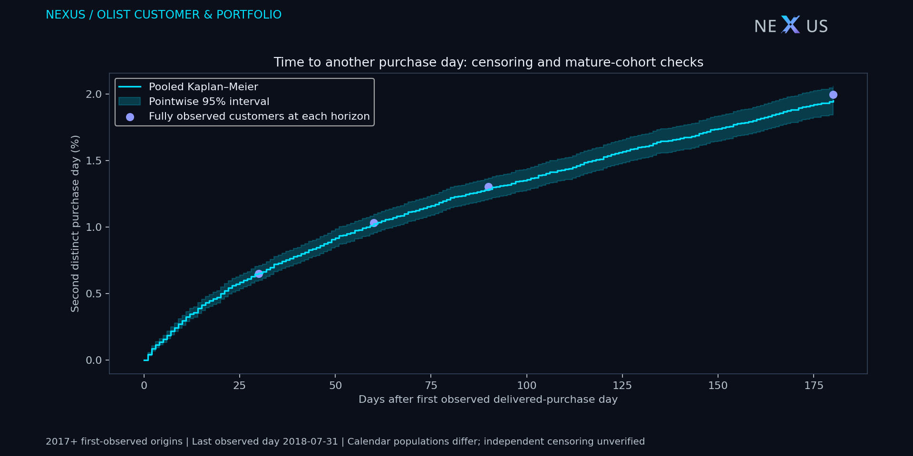
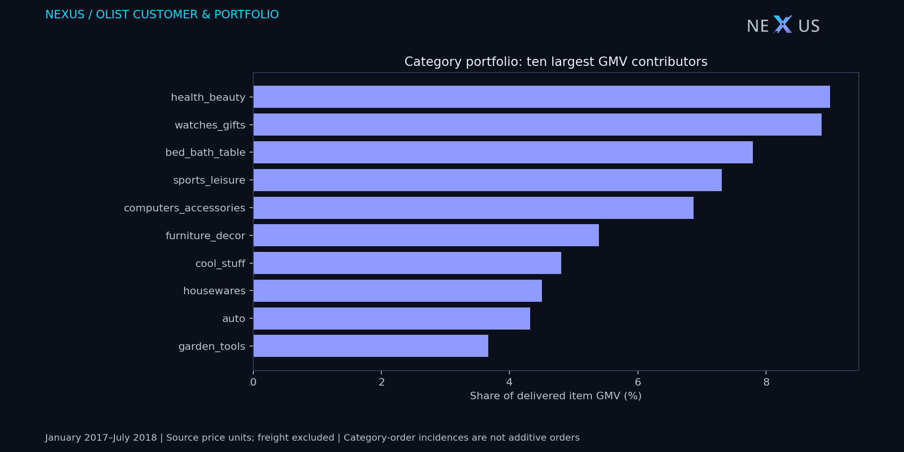

# Olist: repeat-purchase timing and portfolio concentration

Independent extension of the [controlled Olist study](REPORT.md), using the same delivered positive-item-GMV purchase window. Source: [Olist public data](https://www.kaggle.com/datasets/olistbr/brazilian-ecommerce). All derived CSVs, figures and the data-containing Olist BI package retain [CC BY-NC-SA 4.0](https://creativecommons.org/licenses/by-nc-sa/4.0/). NEXUS authored the transformations; no endorsement by Olist is implied. E-Commerce and Greenweez populations remain separate.

## Findings and implications

- **86,950 observed customer origins**, beginning January 2017. Pooled Kaplan–Meier probability of another distinct purchase day by day 90 is **1.29%**, with pointwise Greenwood log-log 95% interval **1.21%–1.37%**. There are 68,243 customers at risk immediately before day 90. This is a historical descriptive estimate, not a forecast or churn probability.
- Among **69,142 customers with a full 90-day observation window**, 903 returned on another day within 90 days: **1.31%**. This maturity check describes an older calendar-origin population; differences from pooled KM do not by themselves establish bias or a trend.
- Across **30,015 observed product IDs**, the top 10 contribute **3.46%** of item GMV and the top 100 contribute **14.15%**. Within-portfolio HHI is **0.000395**, equivalent to **2,529.9 equally weighted products**. This measures SKU value concentration within this extract, not market power or competition between firms.

Use repeat timing to frame follow-up experiments rather than assigning customer intent. Use category/value concentration to prioritize catalog investigation; the extract lacks stock availability, reliable cost, margin and demand exposure, so it does not justify delisting products or optimizing profit.





## Method and observation contract

**Endpoint:** first purchase on a different calendar day after the customer's first observed delivered positive-GMV purchase. Multiple orders on one day count as one purchase day; the endpoint is not identical to second order, active-in-month retention or customer churn. Determine first observed purchase using the entire pre-cutoff extract, including 2016, then restrict origins to 2017+. Customer identity is `customer_unique_id`. Pre-extract and other-marketplace history are unobserved. Frozen delivered status makes this retrospective; it is not a historical as-of status reconstruction.

**Censoring:** last included purchase day is 2018-07-31; a customer originating that day has zero complete days of follow-up. Non-repeat durations end on that day, not on the excluded 2018-08-01 boundary. Tied events are counted before same-day censor removals. Kaplan–Meier uses the full grouped duration ledger when computing risk sets; published daily curves stop at 180 days. Greenwood log-log intervals are pointwise, not a simultaneous band. Intervals at survival 0/1 are undefined and remain null. Independent censoring and homogeneous calendar behavior are not established; administrative follow-up length depends on origin date. Rates among mature customers at 30/60/90/180 days are published as separate descriptive checks, each with its own eligible denominator. They are not interchangeable calendar cohorts.

**Portfolio:** product item values join to validated one-row-per-order facts; product and category-translation keys must be unique and non-null. Missing categories remain in an explicit unknown bucket, and untranslated labels retain the source language. Coverage counts are recorded. Whole-window item GMV must reconcile independently to the order fact within 0.005 source units. Category orders are incidences: an order containing two categories contributes to both, so category counts must not be summed as unique orders. Product IDs are used only inside local memory; public tables contain categories and concentration aggregates. Top-k is based on descending product GMV, with stable identity tie-breaks. HHI uses GMV shares squared; effective product count is its reciprocal. Quarterly comparisons include only complete quarters January 2017–June 2018; July's partial quarter is excluded.

## Reproduce

The four base files remain unchanged. Two further official CSVs are required: `olist_products_dataset.csv` and `product_category_name_translation.csv`; fetch with `python -m scripts.fetch_olist --products`. Inputs remain under ignored `target/olist/raw/`.

```powershell
python -m scripts.olist_customer_portfolio --out target/olist/extension
python -m unittest discover -s tests -p test_olist_customer_portfolio.py -v
python -m scripts.build_olist_powerbi --extension target/olist/extension
```

`extension_evidence.json` records source, query, implementation and aggregate hashes. Public outputs contain no customer, order or product identifiers. Native BI source/schema validation does not establish Desktop rendering, refresh or DAX execution. No browser, screen automation, paid resource or cloud query is needed.
