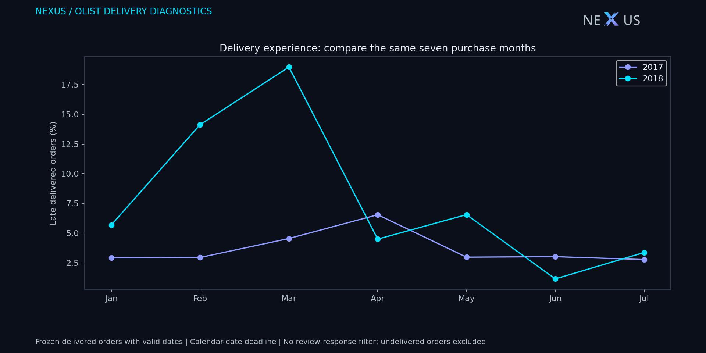
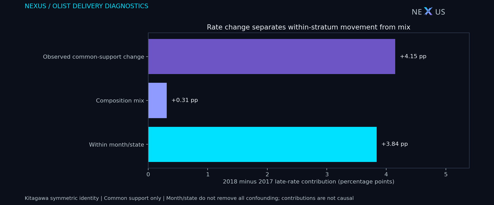

# Olist delivery: comparable periods, composition and review priorities

Decision: **where should an analyst begin a delivery root-cause review?** This historical diagnostic uses the [official Olist public extract](https://www.kaggle.com/datasets/olistbr/brazilian-ecommerce), independently of E-Commerce/Greenweez and independently of review-response selection. Derived CSVs, figures and the data-containing Olist BI report retain [CC BY-NC-SA 4.0](https://creativecommons.org/licenses/by-nc-sa/4.0/). NEXUS authored the transformations; no endorsement is implied.

## Readout

- January–July 2017: **647/17,804** eligible delivered orders were late (**3.63%**). January–July 2018: **3,685/46,426** (**7.94%**). Full-sample change: **+4.30 percentage points**, customer-cluster bootstrap pointwise 95% interval **+3.94 to +4.67 pp**, 1,000 fixed-seed replicates. This is observed experience among delivered orders, not a causal treatment effect or a current service-level claim.
- Common support retains **102 month/state strata**, each with >=20 orders in each year: **95.87%** of 2017 eligible orders and **94.60%** of 2018. Within this subset, the crude change is **+4.15 pp**. Symmetric Kitagawa contributions are **+3.84 pp within strata** and **+0.31 pp composition mix**; their sum reconciles exactly.
- With pooled-order weights fixed across those same strata, standardized rates are **3.52%** and **7.47%**. These are descriptive sensitivity estimates without an adjusted confidence interval. Their pooled weights differ from Kitagawa's average-of-year-weights convention; do not substitute one for the other.
- **March** has the largest absolute within-stratum contribution: **+2.21 pp**. Use the published monthly contribution ledger to focus the first record-level investigation. This arithmetic contribution is not evidence of a specific disruption, carrier failure or intervention effect.
- The five states with the largest **observed 2018 late-order burden** among states with >=100 eligible orders are **SP, RJ, MG, BA, RS**. They account for **67.95%** of all eligible 2018 late orders. These are investigation priorities by volume, not a statistically established ranking of service quality. Large states can have high counts with moderate rates; all states and denominators remain in the CSV.





## Decision and next evidence

Start with the high-burden states and month/state cells contributing most to the observed change. Inspect carrier handoff, seller dispatch, promised lead times and route-level records before proposing an intervention. This extract does not identify a cause. A pilot would need a defined comparison group and contemporaneous dispatch/delivery data; do not assign revenue uplift or avoided losses to these descriptive differences.

Primary measurement: late delivered-order rate using the same calendar-date deadline. Guardrails: undelivered/cancelled order share, promised lead time, transit-time percentiles and missing-date coverage. The delivered-only rate could improve by lengthening promises or excluding non-deliveries, so it cannot be used alone as an optimization target. The output `delivered_late_gmv` is item GMV associated with already delivered late orders, **not lost revenue, profit or refund exposure**.

## Method and limits

One row per validated order. Eligibility: final status delivered; positive item GMV; purchase in January–July of 2017 or 2018; customer identity available; actual delivery >= purchase timestamp; estimated delivery date >= purchase calendar date. Late = actual delivery calendar date later than estimated calendar date. Source timestamps are used as stored, with no inferred timezone conversion. Review availability, score and answer timing are never eligibility criteria. This differs intentionally from the review-association sample in the [base study](REPORT.md).

Coverage counts and overlapping exclusions are in `operations_evidence.json`. A raw-order/customer/item-existence query independently reconciles the eligible denominator. Monthly and stratum counts reconcile to the full sample. Customer identities are resampled with all their eligible orders across both years (62,529 clusters); the interval describes the **full eligible sample's crude rate change only**, not common-support, standardized or decomposition components. Bootstrap settings: seed 20261028, 1,000 valid replicates. These sampling intervals do not correct selection, confounding or incomplete marketplace coverage.

Common-support selection is fixed before comparison using order counts, not late outcomes. Kitagawa identity: sum(mean year weights × year rate change) + sum(mean year rates × year weight change). Neither component is a causal effect; product, seller, carrier and route composition can still change inside month/state cells. Common-support coverage loss changes the analyzed population, so the full and restricted changes must be kept separate. Pooled standardization uses combined year-specific order counts as weights. States with low volumes remain visible but are excluded from the five-state review-priority list below the stated threshold. No selected state's rate is declared superior or significant.

Both calendar windows have seven purchase months. Frozen delivered status may reflect outcomes after purchase-window end; this is a retrospective comparison, not reconstructed as-of operations. Undelivered, cancelled and missing-date orders can have different experience and are outside this endpoint. The analysis is historical and observational; it cannot isolate an operational mechanism or forecast current performance.

## Reproduce

```powershell
python -m scripts.olist_delivery_operations --out target/olist/operations
python -m unittest discover -s tests -p test_olist_delivery_operations.py -v
python -m scripts.build_olist_powerbi --operations target/olist/operations
```

The four official base CSVs suffice. Raw identifiers remain under ignored `target/`; outputs are aggregated by period, state and month/state. The native BI package is editable source, with Desktop rendering, DAX execution and refresh unverified. No browser, Playwright, PC-screen control, paid resource or cloud query is used.
