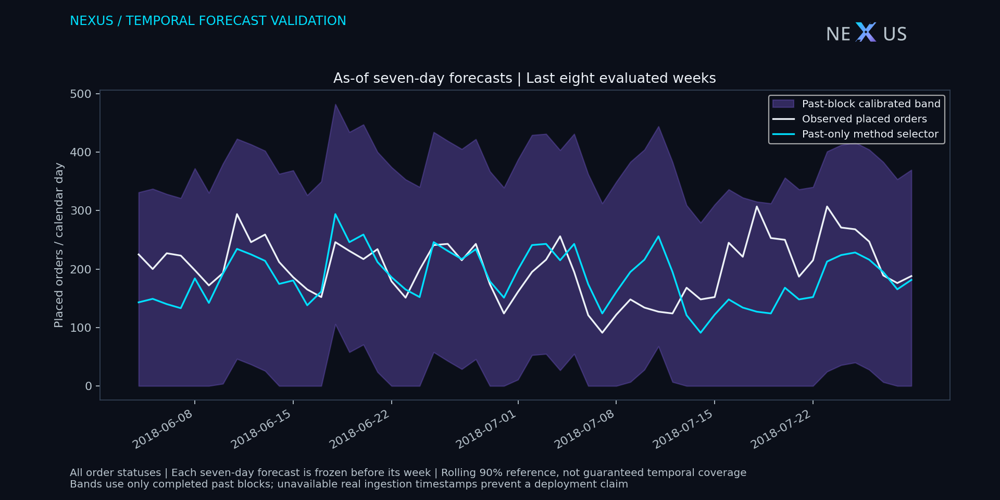
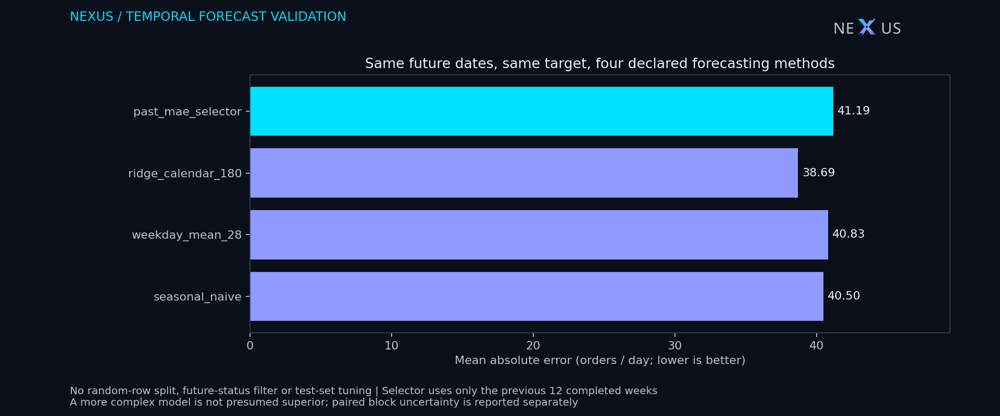

# Olist order-volume forecasting: temporal evaluation and uncertainty

## Question and readout

Can an analyst improve seven-day order-volume forecasts over repeating last week's daily counts **without using future observations to choose or calibrate a method**? This retrospective benchmark evaluates **30 non-overlapping weeks / 210 days** from 2018, using a fixed [retrospective protocol](olist_forecast_protocol.json). The target counts **all placed orders**, including cancelled, undelivered and itemless orders. It differs from delivered GMV/order populations elsewhere in this project.

The declared past-only selector has MAE **41.19 orders/day**, versus **40.50** for seasonal naive. Paired mean improvement (baseline MAE minus selector MAE) is **-0.69 orders/day**; a four-week circular moving-block bootstrap pointwise 95% percentile interval is **-4.67 to +3.06**. Positive values favor the selector. This is one prespecified retrospective comparison; the protocol was created after earlier Olist studies, so it is not prospective preregistration or a confirmatory test. Block-length sensitivity appears below; a limited historical period cannot establish future superiority.

| Method | MAE | RMSE | WAPE | MASE | Whole-week band coverage | Mean interval score |
| --- | ---: | ---: | ---: | ---: | ---: | ---: |
| seasonal_naive | 40.50 | 54.68 | 18.15% | 1.234 | 93.3% | 588.10 |
| weekday_mean_28 | 40.83 | 54.67 | 18.29% | 1.243 | 93.3% | 573.90 |
| ridge_calendar_180 | 38.69 | 50.09 | 17.34% | 1.179 | 93.3% | 495.68 |
| past_mae_selector | 41.19 | 54.29 | 18.45% | 1.253 | 93.3% | 551.62 |

The selector's day-level band coverage is **97.6%**, whole-week coverage **93.3%**, and mean daily width **534.57 orders**. The reference target is 90% **whole-week** coverage; day and whole-week coverage are different metrics. Neither is guaranteed for dependent, drifting data. Interval scores penalize width and misses, so broad bands are not automatically good forecasts. Model ranking by one retrospective number is not a deployment recommendation.

**Decision:** the primary selector comparison does not demonstrate an improvement over seasonal naive in this historical evaluation. Keep the seasonal baseline as a reference and assess new future periods before promoting a more complex method. The ridge candidate's lower observed MAE is exploratory; choosing it after inspecting this evaluation would require a fresh future validation period. High empirical coverage with very wide bands does not establish useful operational precision.

## Target, chronology and leakage controls

The complete daily grid is [2017-01-01, 2018-08-01); zero-count days represent no records in this frozen extract, not verified marketplace downtime. A separate streaming CSV counter reconciles every date and the total; no order status, review, delivery date, item value or future customer outcome filters the target. Timestamps are used as stored, without inferred timezone conversion. Public extraction completeness and real ingestion/availability timestamps are unknown.

Monday origins start 2017-09-25; each forecast covers the next seven calendar days, using history strictly before its origin. Pre-2018 origins initialize selection and calibration. Scored origins begin 2018-01-01; the final incomplete week is excluded, leaving 30 July and 31 July 2018 unscored. Forecast weeks do not overlap. Once an evaluated week ends, its outcomes may inform **later** origins: this is sequential rolling-origin evaluation, not a fixed unchanging training set. Future-perturbation tests verify that later outcomes cannot change earlier predictions, selections or interval endpoints. Training-end and calibration-end dates are retained in every prediction row.

Declared methods: seasonal naive repeats the previous seven counts; weekday mean averages the last four corresponding weekdays; calendar ridge fits counts to an intercept, a linear time term scaled by 180 days and six weekday indicators using the last 180 days, penalty 10.0 on non-intercept coefficients, then clips point forecasts at zero. The selector chooses among these three using only mean MAE from at most the previous 12 completed forecast weeks; ties use the declared order, and the first origin defaults to seasonal naive. No hyperparameter, window or candidate is tuned on evaluation results.

## Calibration, metrics and uncertainty

For each method, each completed week supplies **one maximum absolute daily error**. Before the next origin, at most the last 12 such scores determine radius q at order-statistic rank ceil((n+1)×0.9), without interpolation. If that rank exceeds available scores, the interval is unavailable, rather than given an invented finite radius. Every scored evaluation week has mature calibration. Each day's band is [max(0, prediction−q), prediction+q]. The selector uses **its own historical errors**, not the errors of whichever candidate it currently selects. Applying these rolling scores does not restore exchangeability; the procedure is conformal-style calibration with empirical coverage assessment, not a finite-sample guarantee.

MAE/RMSE pool the identical held-out dates. WAPE = total absolute error / total actual count; it is not an average of daily percentage errors. MASE divides each week's MAE by that origin's **past-only** mean absolute seven-day seasonal difference, then averages weekly scaled errors; zero training scale remains unavailable. Interval score = width + (2/alpha)×distance below/above the interval when missed, alpha=0.1. The CSV also reports day coverage, complete-week coverage and width. These are different aspects of performance.

Paired inference uses baseline-minus-selector **weekly** MAE differences. Circular moving-block resampling retains adjacent weeks and the pairing of methods, with 2,000 fixed-seed replicates. One-, four- and eight-week blocks expose sensitivity to the dependence assumption; wraparound is an approximation and 30 scored weeks provide limited information. No p-values, best-of-many significance claim, or simultaneous confidence guarantee is produced.

| Resampling block (weeks) | Mean MAE improvement | Pointwise 95% interval (orders/day) |
| --- | ---: | ---: |
| 1 | -0.69 | -4.76 to +3.45 |
| 4 | -0.69 | -4.67 to +3.06 |
| 8 | -0.69 | -4.22 to +2.44 |

## Reproduce and use

Run `python -m scripts.olist_forecast --raw target/olist/raw --out target/olist/forecast`, or `python -m scripts.build_research --schemas` for all studies and native BI. Aggregates: `forecast_volume.csv`, `forecast_daily.csv`, `forecast_folds.csv`, `forecast_metrics.csv`, `forecast_uncertainty.csv`. The [daily SQL](daily_order_volume.sql), protocol, evidence fingerprints and two figures accompany the report. Raw order/customer identifiers remain local. The native forecasting page embeds evaluation-only selector daily values and fixed benchmark metrics; date selection does not refit models or recompute full-period benchmark cards. Native rendering, refresh and DAX execution remain unverified.

Use this as a forecasting-method and scientific-validation demonstration. Before staffing/inventory use, obtain real ingestion timestamps, a stable business calendar, a current series, repeated future evaluation, and intervention/capacity cost information. No revenue forecast, causal uplift, profit or live-service readiness is claimed. The project remains non-commercial with zero recurring infrastructure cost. Source: [official Olist public dataset](https://www.kaggle.com/datasets/olistbr/brazilian-ecommerce); derived data, figures and the data-containing BI package retain [CC BY-NC-SA 4.0](https://creativecommons.org/licenses/by-nc-sa/4.0/).

Method references: [Hyndman and Athanasopoulos, rolling-origin evaluation](https://otexts.com/fpp3/tscv.html), [forecast accuracy definitions](https://otexts.com/fpp3/accuracy.html), and [Stankeviciute et al., Conformal Time-Series Forecasting](https://papers.neurips.cc/paper/2021/file/312f1ba2a72318edaaa995a67835fad5-Paper.pdf). These motivate chronology, metrics and caution about temporal exchangeability; this benchmark does not implement that paper's algorithm or claim its guarantees. All numerical findings above are computed from the local official CSVs.
