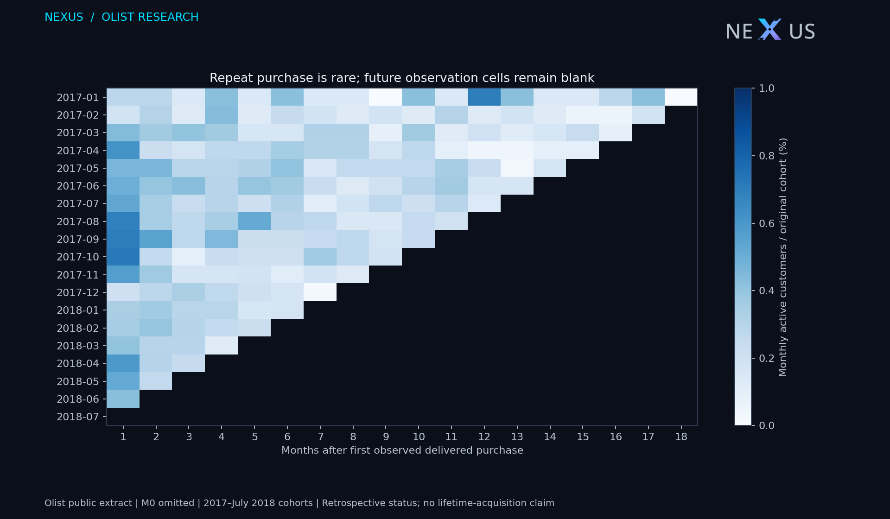
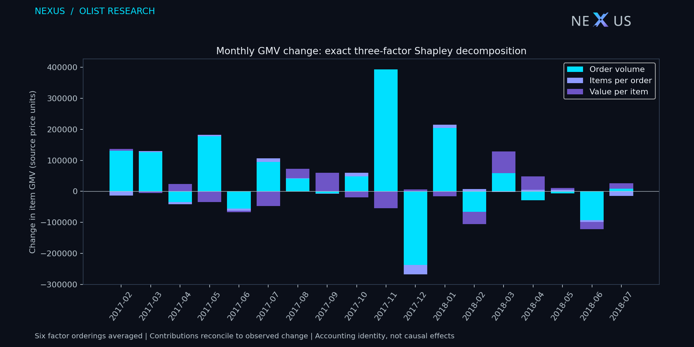
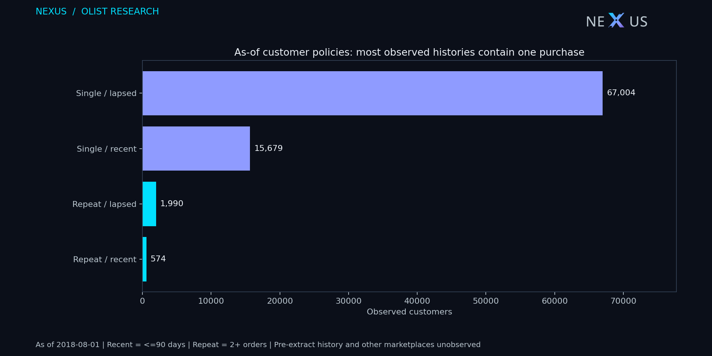
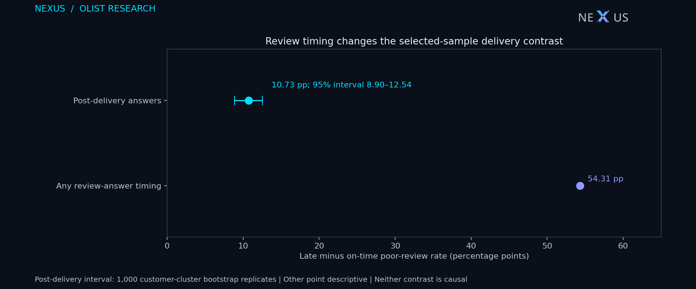

# Olist: repeat purchase, value drivers and delivery experience

This independent historical study uses the [official Olist public dataset](https://www.kaggle.com/datasets/olistbr/brazilian-ecommerce), licensed CC BY-NC-SA 4.0. It is a non-commercial NEXUS portfolio analysis. It is never combined with E-Commerce, Greenweez or GA4 populations.

Olist-derived aggregate CSVs, figures and the data-containing Olist BI package retain [CC BY-NC-SA 4.0](https://creativecommons.org/licenses/by-nc-sa/4.0/). NEXUS authored the analytical transformations; Olist does not endorse this study. Software code follows the repository's separate license.

## Results and decisions

- **89,860 delivered orders**, 86,960 observed customer identities and **12,342,450.49 item GMV in source price units** in [2017-01-01, 2018-08-01). Item GMV excludes freight, cancelled orders, refunds, fees and tax accounting; it is not net revenue or profit. Currency conversion is not performed.
- Across 18 fully observable cohorts, 389 of 81,001 original customers purchased again in month 1: **0.48%** (cohort-size weighted). This replaces the unverified 3–5% month-1 narrative in the historical SQL notebook. Investigate repeat-purchase economics before projecting recurring customer value; do not infer churn from this marketplace extract.
- Within the **post-delivery review-answer sample**, late orders had **10.73 percentage points** more poor reviews than on-time orders (customer-cluster bootstrap percentile 95% interval **8.90–12.54 pp**, 1000 fixed-seed replicates). Late: 342/1,702 poor; on-time: 7,777/83,061. Investigate delivery reliability; this observational contrast does not estimate the effect of a delivery intervention.
- **Review-timing sensitivity:** including reviewed orders regardless of whether the answer preceded actual delivery gives a crude difference of **54.31 pp**. The contrast depends strongly on the response-time restriction: pre-delivery complaints and later answers represent different selected populations. Neither is an unbiased intervention effect.
- The common-month standardized difference is **11.04 pp** across 13 months with at least 30 orders in each exposure group. This is a descriptive sensitivity check without an adjusted confidence interval, not confounding control sufficient for causal inference.









## Definitions fixed before interpretation

The first excluded purchase date is **2018-08-01**. July 2018 is the last included purchase month; August and the sparse September/October tail are excluded conservatively. This is a frozen retrospective extract, not a currently operating business or a reconstructed historical database snapshot.

**Cohorts:** first observed delivered-purchase month across all pre-cutoff history, including 2016. Display starts January 2017. The denominator remains the original customer cohort; within-month multiple orders count once. All observable cohort/period pairs are generated, including true zeros. Cells outside the purchase observation window are null, never zero. Month 0 is 100% by construction. Customer identity is `customer_unique_id`, not the per-order `customer_id`. Missing pre-extract or other-marketplace history prevents a lifetime acquisition or customer churn claim. Frozen delivered status may include deliveries after cutoff, so this panel is retrospective, not an as-of forecast.

**RFM:** purchases and actual deliveries must both precede cutoff; impossible delivery chronology is excluded. 2,030 otherwise eligible historical orders fail this delivery-time gate. Frequency is exact order count; monetary is item GMV. Four policy segments combine frequency 1 versus 2+ and recency <=90 versus >90 days. The 90-day threshold is an explicit demonstration policy, not an optimized business recommendation. Equal histories receive equal segments; no NTILE splits ties. No predicted CLV or invented customer intent is assigned. Earlier observed history is included, making this population different from the 2017+ monthly totals.

**GMV decomposition:** delivered purchase months from January 2017. GMV = orders × items/order × GMV/item. Each factor's contribution averages all six replacement orders (Shapley). Components reconcile to each adjacent month's exact observed change. Freight is reported separately; returns are not available as a refund ledger. This is accounting attribution, not an explanation of marketing causality or a forecast.

**Delivery/reviews:** one deterministic latest review per order; actual delivery is later than the estimated calendar date for the late flag. Poor = score 1–2. Require actual/estimated dates with valid purchase chronology and a review answer timestamp at or after actual delivery. Delivery and review outcomes can occur after the purchase cutoff because this is retrospective. Excluding pre-delivery/missing reviews creates selection bias; nonrespondents and pre-delivery complaints are outside this estimand. Bootstrap resamples customer identities with all their orders; it does not fix confounding, nonresponse, marketplace selection or review deduplication bias. Month standardization weights common-support months by pooled eligible orders. State-specific Fisher tests are exploratory: >=30 orders per exposure, all 13 eligible states form one Benjamini–Hochberg family. Fisher's order-independence assumption is imperfect for repeat customers, so these q-values are screening diagnostics, not confirmatory evidence. No single state is selected as a winner.

## Grain and reproducibility

Raw order and customer keys must be unique/non-null; item `(order_id, order_item_id)` keys must be unique. Relationships, positive item prices, nonnegative freight and review scores are checked. Item values aggregate before review/customer joins. Latest review selection sorts answer time, creation time, review ID and score; 551 extra review rows are collapsed. Exact duplicate answers are equivalent for all retained fields. Order fact has 99,441 rows. Raw item value reconciles to the entire order fact within 0.005 source units. 775 orders have no item rows; positive-GMV analyses exclude them.

CSV tables beside this report are aggregates only. `evidence.json` records full source-file SHA-256 hashes, row counts, query hashes, eligibility and statistical settings. No customer IDs, order IDs, addresses or review text are exported. Source files remain in ignored `target/olist/raw/`.

```powershell
# Requires an authenticated free Kaggle CLI (`pip install kaggle`).
# Downloads only these four official tables, keeping existing CSVs:
# olist_orders_dataset.csv, olist_customers_dataset.csv,
# olist_order_items_dataset.csv, olist_order_reviews_dataset.csv
python -m scripts.fetch_olist
python -m scripts.advanced_olist --raw target/olist/raw --out target/olist/analysis
python -m unittest discover -s tests -p 'test_advanced_olist.py' -v
python -m scripts.build_olist_powerbi --source target/olist/analysis
```

Native Power BI consumes these aggregate outputs in an independent portable project. JSON schema and TMDL parsing do not establish Desktop rendering, refresh or DAX execution. Generated figures are analytical plots, not BI screenshots. No browser, Playwright, screen automation, paid service or cloud query is needed.
