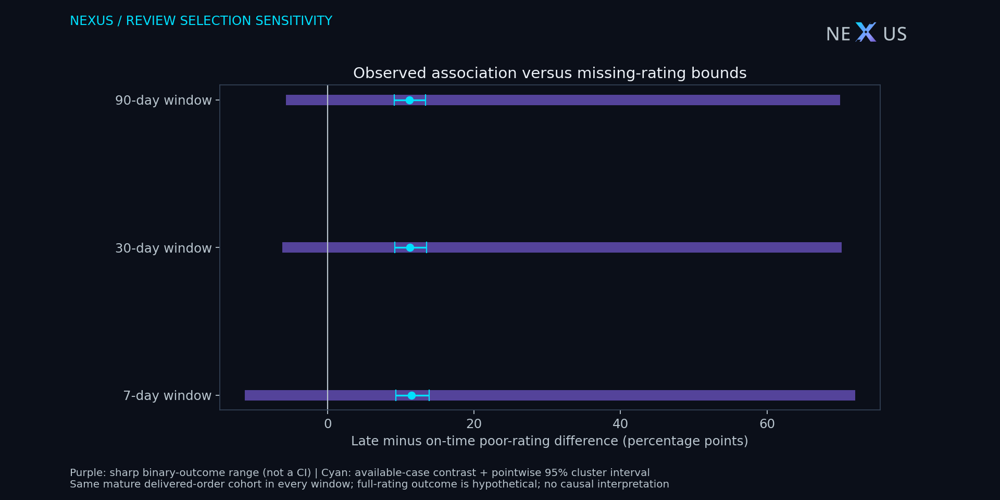
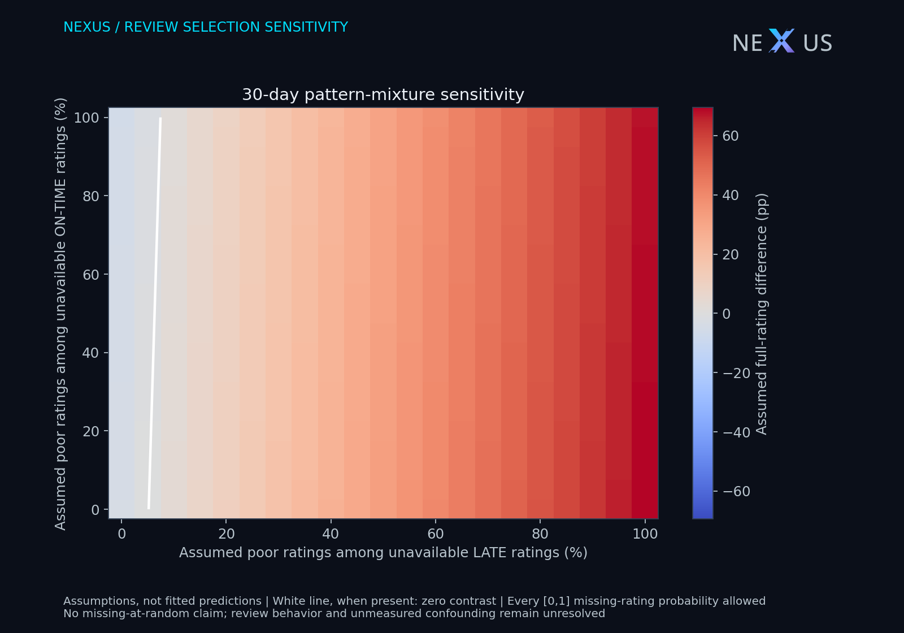

# Olist review selection: missing outcomes and scientific sensitivity

## Research question and answer

How sensitive is the descriptive late-versus-on-time poor-rating contrast to unavailable post-delivery ratings? On the fixed mature cohort of **68,448 delivered orders**, the primary 30-day available-case difference is **+11.26 percentage points** (customer-cluster pointwise 95% percentile interval **+9.18 to +13.49 pp**). Allowing every unavailable rating to be either poor or not poor yields the sharp range **-5.44 to +69.44 pp**, which **includes zero**. This is a missing-outcome robustness statement within this selected historical delivered cohort, not a causal delivery effect or proof that missing ratings resemble observed ones.

Thirty-day response coverage is **1,334/4,984 (26.77%)** for late orders and **62,416/63,464 (98.35%)** for on-time orders. Responses before delivery, after a window endpoint or on/after the cutoff are unavailable for that window. Unavailable ratings are not scored as good. The hypothetical target is the poor-rating proportion if every eligible order supplied a rating within the window; whether such a rating is well defined for every nonrespondent is itself a limitation.

**Availability is not the same as nonresponse.** In particular, pre-delivery-only answers are existing reviews excluded by the temporal definition. Delivery timing and review timing jointly determine selection. The reason ledger distinguishes that mechanism from absent dated answers and late answers; none is diagnosed as a capture failure from this extract alone.

| Delivery group | Primary-window availability | Orders |
| --- | --- | ---: |
| Late | no_dated_answer_before_cutoff | 123 |
| Late | observed_within_window | 1,334 |
| Late | post_delivery_answer_after_window | 19 |
| Late | pre_delivery_answers_only | 3,508 |
| On time | no_dated_answer_before_cutoff | 419 |
| On time | observed_within_window | 62,416 |
| On time | post_delivery_answer_after_window | 466 |
| On time | pre_delivery_answers_only | 163 |

## Locked retrospective protocol

The machine-readable [analysis plan](olist_review_protocol.json) fixes eligibility, primary 30-day window, 7/90-day sensitivity windows, score threshold, review policy and resampling seed. It was written for this extension **after earlier related Olist analyses**; it is not prospective preregistration or an independent confirmatory replication. No window or subgroup is selected by its significance; no p-value search or group ranking is used.

Purchases start 2017-01-01; observation ends strictly before 2018-08-01. All windows use the **same** cohort: final delivered status; positive item GMV; known customer identity; actual delivery at/after purchase; promised calendar date at/after purchase date; delivery plus 90 days strictly before cutoff. This maturity restriction prevents unequal administrative follow-up across windows, at the cost of excluding later deliveries. It does not verify that the public extract captured every review. Late means actual delivery **calendar date** exceeds promised calendar date. Timestamps are used as stored; no timezone conversion is inferred.

Within each window choose the **first** raw review answer at/after delivery and at/before its endpoint, with answer strictly before cutoff. Ties use creation timestamp, review ID and score ascending, nulls last. The base study's latest-review policy is deliberately not reused: a later answer must not hide an eligible earlier answer. Poor = score 1–2; the threshold is not tuned. Existing earlier-study estimates use different populations and cannot be substituted for this result.

## Estimands and derivation

For group g let N_g be eligible orders, R_g observed ratings, P_g observed poor ratings and M_g=N_g−R_g. Available-case poor rate = P_g/R_g. Without a distributional assumption on unavailable binary ratings, the hypothetical full-rating rate lies in **[P_g/N_g, (P_g+M_g)/N_g]**. The late-minus-on-time range is **[P_L/N_L − (P_O+M_O)/N_O, (P_L+M_L)/N_L − P_O/N_O]**. These endpoints are attained by assigning every unavailable late/on-time rating opposite outcomes. They describe identification uncertainty conditional on the observed counts, **not a confidence interval** and not a bound on a causal effect.

For assumed unavailable-rating probabilities q_L and q_O, the pattern-mixture identity is **D(q_L,q_O)=(P_L+M_L q_L)/N_L − (P_O+M_O q_O)/N_O**. The full [0,1]×[0,1] grid explores assumptions rather than imputing truth. Setting each q to its group's observed poor rate reproduces the available-case contrast; that equality is algebra, not evidence of exchangeability. `review_tipping.csv` solves D=0 for q_O at each q_L. Thresholds outside [0,1] are deliberately retained as infeasible; missing q_O thresholds mean the on-time group has no unavailable ratings. The corner scenarios independently reproduce both sharp endpoints.

## Validation and uncertainty

An independent raw-order/customer/item pandas calculation reconstructs cohort membership and first-review selection; every group/window poor count, response count and denominator must equal the SQL output. One order/window row and an independently reconciled customer-cluster ledger prevent join fanout. Resampling retains all eligible orders and all three windows for each customer. Identical customer count ledgers are grouped and their frequencies drawn from a multinomial distribution: this has exactly the empirical customer-bootstrap distribution while reducing memory and computation. The fixed-seed 1,000-replicate bootstrap reports **pointwise** intervals for the available-case contrast and, separately, each bound endpoint. Endpoint intervals in `review_summary.csv` are **not** a simultaneous confidence region for the partially identified set. Shared-cohort 7/30/90-day comparisons are sensitivity analyses, not independent experiments. No multiplicity-adjusted confirmation is asserted.

The data are an observational marketplace extract, not a probability sample. Bootstrap sampling stability cannot establish representativeness, capture completeness, missing-at-random, removal of confounding, or causal effects. Selection on delivered status and early enough deliveries changes the population. Customer expectations, seller behavior, product mix and delivery severity can affect both response and ratings. The outcome-definition assumption for nonrespondents remains untestable.

## Reproduction, sources and outputs

Run `python -m scripts.olist_review_selection --raw target/olist/raw --out target/olist/review-selection`, or build the complete bundle with `python -m scripts.build_research --schemas`. Raw inputs stay local; exports contain only aggregate counts, ranges, assumptions and checksums. Files: `review_groups.csv`, `review_summary.csv`, `review_sensitivity.csv`, `review_tipping.csv`, `review_availability.csv`, `review_selection_evidence.json`, this report and two figures. The bundle also includes the retrospective protocol and [query](review_selection.sql) so its links remain usable.

Source: [official Olist public extract](https://www.kaggle.com/datasets/olistbr/brazilian-ecommerce); NEXUS transformations and data-derived artifacts retain [CC BY-NC-SA 4.0](https://creativecommons.org/licenses/by-nc-sa/4.0/). The approach follows the principle of varying unverifiable missing-outcome assumptions explicitly; see [National Research Council, Principles and Methods of Sensitivity Analyses](https://www.ncbi.nlm.nih.gov/books/NBK209895/) and [Sterne et al., 2009](https://pubmed.ncbi.nlm.nih.gov/19564179/). Those works motivate sensitivity analysis; this report derives its own binary-outcome arithmetic and makes no clinical-trial analogy to randomization. No external source supplies the numerical results above.

Decision: retain response coverage and missing-outcome sensitivity beside the observed association. Investigate review invitation/capture logs and non-delivery outcomes before intervention design. No profit, avoided-loss or revenue-uplift estimate is supported. This remains a non-commercial research portfolio with no recurring paid infrastructure. Native Power BI rendering, refresh and DAX execution remain unverified.
