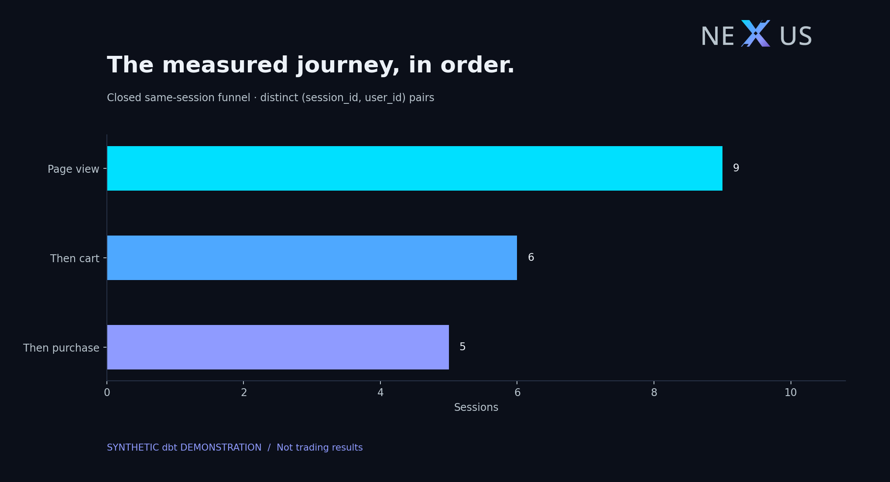
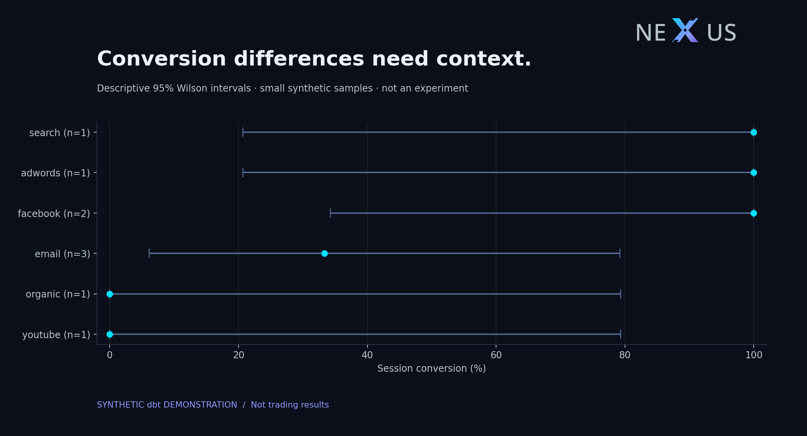
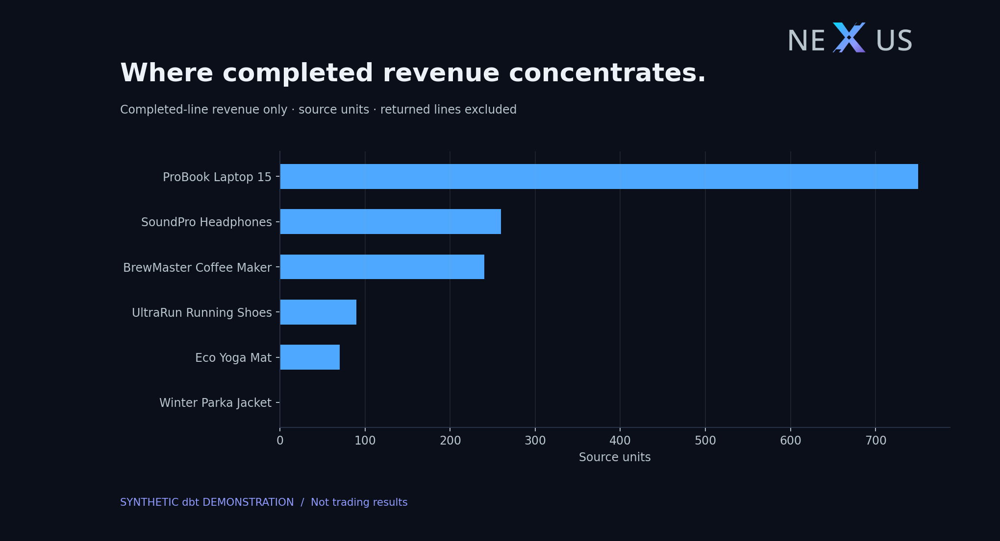
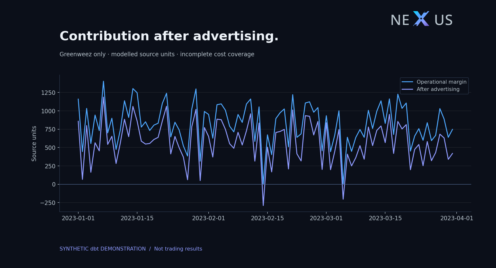

# NEXUS Commerce — analytical findings

**Scope:** reproducible synthetic dbt fixtures; demonstration of method, not actual business performance.
**Order window:** 2022-11-01 to 2022-11-15.

## Questions and findings

1. **Does reported revenue reconcile?** 1,409.91 source units of completed-line revenue reconcile independently from raw order-item seeds to the order mart and channel result. There are 9 period-distinct completed orders. Returned item value is separate; no second subtraction is applied.
2. **Where does the measured journey narrow?** Of 9 session/user pairs, 9 contain a page view, 6 proceed to a cart, and 5 subsequently purchase within the same session. Session IDs shared by different users stay separate; repeated events count once.
3. **Can we rank channel conversion confidently?** The session mart reports 55.56% event conversion. The chi-square expected-cell condition is NOT satisfied. Do not report a chi-square p-value or declare a winning channel from this tiny fixture. Descriptive Wilson intervals accompany each channel; repeated users may violate independent-trial assumptions.
4. **Which products warrant investigation?** Product revenue and eligible returned-item share are exported in `top_products.csv`. Small denominators preclude product-quality or causal claims; a return is not evidence of a defect.

## Greenweez finance — independent domain

Across 90 synthetic daily observations, 253,408.53 source units of revenue reconcile from raw sales to the daily finance mart. Advertising cost is 22,616.93; reported contribution after advertising is 51,820.53. The identity `operational_margin - ads_cost = ads_margin` reconciles by day. These amounts are never added to E-Commerce revenue.

**Quality limits:** 33 orders lack a shipping record and 23 sales lines lack a matching product. Missing components follow the existing model's zero/exclusion policies. The resulting contribution is a model output, not audited net profit; recover missing costs before a real profitability decision. `greenweez_finance.csv` exposes all daily aggregates. Refund worksheet units remain unverified and are not subtracted from this raw-sales branch.

## Cost coverage before contribution interpretation

E-Commerce has 9 completed item rows and 100.00% completed-value coverage by nonnegative product unit costs. Known-cost product contribution is 662.62 source units, computed on the same known-cost completed rows as its revenue denominator. It excludes shipping, logistics and advertising, and is not a margin estimate for unpriced rows. `completed_product_contribution.csv` publishes category-level coverage and the matched-denominator margin rate.

Greenweez has 1,546.84 source units of sales value on unpriced/invalid-component lines. Its established product-margin aggregation excludes those missing line margins while retaining sales revenue. Of 1226 order records, 55 have incomplete product/shipping components under the explicit nonnegative-component policy. Reported operational margin is 74,437.46; the complete-component order subtotal is 71,381.51. These are different populations, not uncertainty bounds, audited profit or an estimate of money lost. Advertising is not allocated to the complete-component subset. `greenweez_cost_coverage.csv` retains every coverage group. The diagnostic leaves the finance model unchanged and independently reconciles source orders, lines and value.

## Visual exhibits

These are generated analytical figures, not screenshots of Power BI or a live dashboard.

## Decision implications

Use this fixture to validate the pipeline and investigate counting assumptions. Do not reallocate a real marketing budget from these numbers. A real decision needs a source-qualified extract, sufficient independent observations, comparable periods and separately verified spend attribution. Greenweez finance, Olist notebooks and GA4 lab events represent separate populations.

## Reproduction and controls

`python -m scripts.run_analysis` executes five E-Commerce SELECT templates plus the independent Greenweez coverage query against read-only dbt marts. `evidence.json` records query/database fingerprints and raw reconciliation controls. CSVs expose all aggregate results. [KPI catalog](../KPI_CATALOG.md) and [source coverage](../SOURCE_COVERAGE.md) define their interpretation. No credentials, customer identifiers or raw event exports enter this report.

**Limits:** synthetic samples; current-status order facts; UTC-like DuckDB fixture dates versus Europe/Istanbul production mart dates; same-session closed funnel excludes cross-session journeys; first-touch attribution is descriptive; no causal marketing uplift, audited profit, cash refunds or real-time freshness is claimed.
