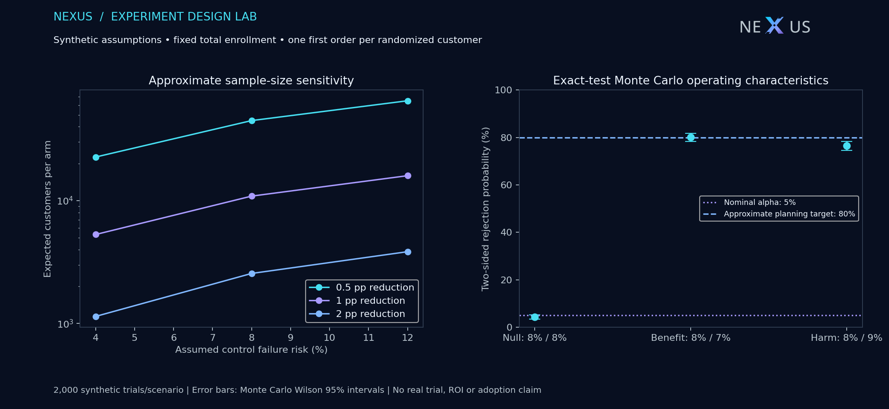

# NEXUS Experiment Design Lab

**Proposed synthetic design; no real trial, prospective preregistration or causal effect has been established.** This is a separate teaching module, not a sixth Olist study. It reads no historical commerce records and does not replace the five public Olist studies or their native report. All rates and target effects below are illustrative assumptions, not measured current-business baselines.

## Question and proposed measurement

Could a future shipment-exception triage intervention reduce failure to deliver by the promised deadline? Randomize eligible customers independently with probability 0.5; use only each customer's first eligible order and preserve assignment. The denominator is every randomized eligible customer, including cancelled and genuinely undelivered first orders. Freeze the promised UTC deadline at assignment. Adjudicate after that deadline plus seven recording days. Missing telemetry remains unknown and blocks complete-outcome analysis; absent records must not be relabelled as physical non-delivery or successful delivery.

Historical Olist lateness was measured among delivered orders. That is a different estimand and cannot supply the failure-risk baseline for this all-randomized-customer endpoint. Customer-level assignment also does not resolve shared queue capacity, geographic interference or warehouse-level treatment spillover. Those need feasibility evidence and possibly a different randomization design.

## Planning sensitivity and simulated operation

The 9-cell grid assumes baseline risks 4%, 8%, 12%, with absolute reductions of 0.5, 1, 2 percentage points. Equal *expected* arm sizes use a pooled-null/unpooled-alternative normal approximation at two-sided alpha 0.05 and target power 0.80. It ignores the far tail and exact-test discreteness. The fixed total for the 8% to 7% demonstration is **21,780 customers**; Bernoulli assignment allows unequal realized arm sizes. No calendar duration is estimated because reliable eligible-customer arrival volume is unavailable. No arbitrary attrition factor converts unknown outcomes into complete data.

For each scenario, 2,000 independent synthetic trials use that fixed total. Counts follow independent binomial assumptions, without seasonality, clustering or interference. Two-sided Fisher testing supplies the rejection indicator. Wilson intervals below describe **Monte Carlo estimation uncertainty**, not treatment-effect uncertainty or evidence from actual customers. The null row estimates Type I rejection; alternative rows estimate rejection power under those particular assumptions. Power is not guaranteed. The harm scenario changes baseline variance in the opposite direction, so the benefit-based sample size does not guarantee the same harm-detection power.

| Scenario | Assumed control / treatment risk | Rejections | Rejection probability [Monte Carlo 95% interval] | SRM flags |
| --- | --- | --- | --- | --- |
| null | 8% / 8% | 86/2000 | 4.30% [3.50%, 5.28%] | 1 |
| benefit | 8% / 7% | 1602/2000 | 80.10% [78.29%, 81.79%] | 1 |
| harm | 8% / 9% | 1529/2000 | 76.45% [74.54%, 78.26%] | 1 |

[Planning grid](sample_size_grid.csv) · [Simulation counts](simulation.csv) · [Machine-readable provenance](evidence.json) · [Proposed contract](../../contracts/delivery_experiment_plan.json).

## Analysis and decision rules

- One primary null: equal binary failure risks; two-sided Fisher test at alpha 0.05. Report treatment-minus-control risk difference, so negative means lower failure risk. Newcombe hybrid Wilson 95% intervals describe that difference. They are not an inversion of the Fisher test, and no p-value/interval equivalence is asserted.
- `evaluate` withholds inference before the fixed enrollment horizon, on enrollment overrun, incomplete outcomes, unverified assignment or sample-ratio mismatch. SRM uses an exact two-sided fair-binomial check at 0.001 under the specified independent Bernoulli assignment. It diagnoses allocation integrity rather than a secondary business outcome. Simulation counts retain all replicates, including SRM/empty-arm cases; no conditional filtering inflates power.
- No optional stopping, interim significance searches, subgroup winner selection or unadjusted secondary confirmatory tests. Guardrails are cancellations/non-delivery, unknown telemetry, workload and queue interference; business thresholds are **unapproved**, not fabricated here.
- A detectable effect is not an approved economically worthwhile effect. Unit costs, guardrail budgets and incremental revenue are unknown. Statistical rejection never automatically recommends adoption. No production assignment, customer contact, commercial launch or paid infrastructure is created.

## Reproduction and sources

Run `python -m scripts.experiment_design` with the existing locked research environment. The contract and implementation hashes, runtime versions and exported-file hashes are retained in `evidence.json`. Fixed seeds make this a reproducible simulation, not prospective registration of an actual study. Simulation assumptions must be replaced and preregistered appropriately before a real trial.

[Normal sample-size approximation](https://www.statsmodels.org/stable/generated/statsmodels.stats.proportion.samplesize_proportions_2indep_onetail.html) · [Fisher exact definition](https://docs.scipy.org/doc/scipy-1.17.0/reference/generated/scipy.stats.fisher_exact.html) · [Newcombe interval methods](https://www.statsmodels.org/stable/generated/statsmodels.stats.proportion.confint_proportions_2indep.html) · [Wilson interval reference](https://docs.scipy.org/doc/scipy-1.17.0/reference/generated/scipy.stats._result_classes.BinomTestResult.proportion_ci.html). Formula implementations and method cross-checks are executable locally. This authored synthetic module remains separate from Olist-derived CC BY-NC-SA artifacts and from private financial data.
